# MacMon

**See what your Mac is doing. Find what's slowing it down.**

MacMon brings CPU, memory, disk, network and GPU activity into one macOS dashboard. Spot a spike, find the busiest processes and launchd jobs, and look back at what was happening when it occurred—all from the same window.

**macOS 13+ · Apple Silicon and Intel builds · Self-contained app · C# and Avalonia**

[Releases](https://github.com/galenblakeman/MacMon/releases) · [Get started](#get-started) · [Example gallery](docs/example/README.md) · [Developer guide](docs/DEVELOPMENT.md) · [Publishing and updates](docs/RELEASING.md)

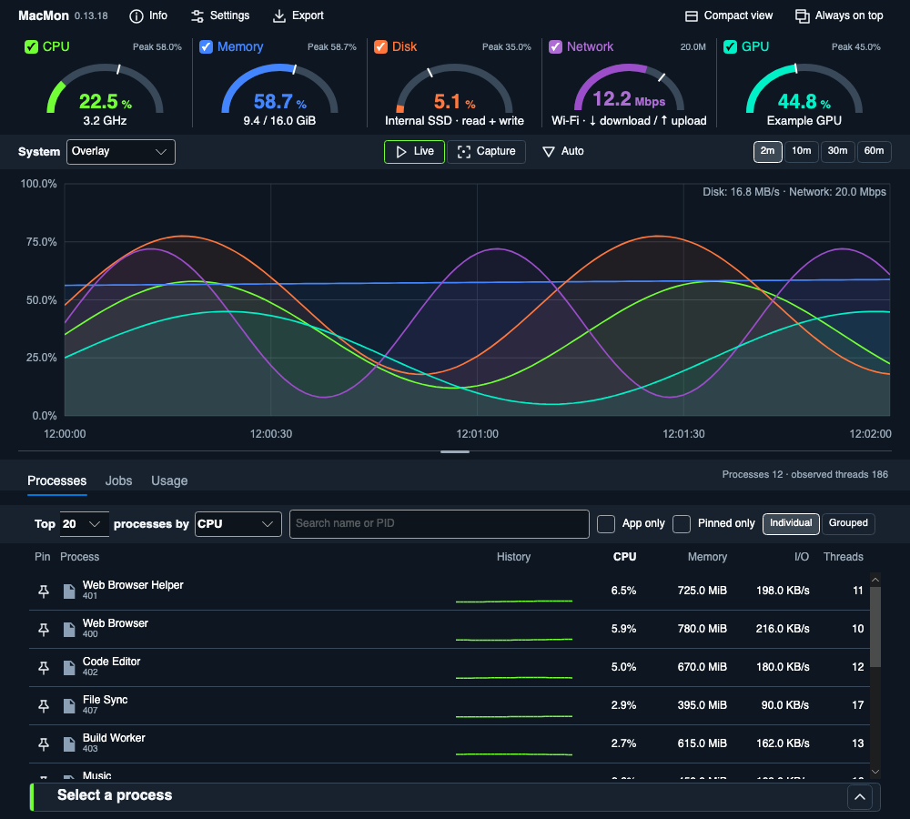

*Examples use illustrative identities and measurements rendered from MacMon 0.13.18 on October 26, 2026. They show app content without native macOS window chrome. See the [gallery](docs/example/README.md) for all views and regeneration instructions.*

## Get started

For a packaged release, extract the ZIP for your Mac, move **MacMon.app** to **Applications**, and open it. Choose `osx-arm64` for Apple Silicon or `osx-x64` for Intel. Self-contained packages include the .NET runtime; no separate runtime installation is needed.

Monitoring runs without administrator privileges. macOS can deny access to individual processes or hardware counters; missing readings stay unavailable and are retried.

Native validation currently covers the M2 Pro on macOS 26.6.2. Intel execution and older supported macOS versions still need hardware validation. Local development packages are ad-hoc signed; official distribution requires the signing and notarization setup described in the [release guide](docs/RELEASING.md).

## Your Mac, at a glance

Live resource readouts sit above a shared timeline, so CPU spikes, disk activity and network transfers can be compared at the same moment.

- **Watch the resources that matter.** Monitor CPU, physical memory, device-wide GPU utilization, network throughput and up to two whole disks. Hide chart traces while recording continues.
- **Compare with a recent peak.** Gauges mark each resource's highest reading over the last two minutes. Arc gauges also print the peak percentage; network shows its download scale.
- **Inspect a reading.** Hover or keyboard-focus a resource readout for live details and measurement definitions. Escape dismisses the tooltip.
- **Choose how history looks.** Use Overlay, Small multiples, Heatmap or a per-resource Focus view. Choose 2, 10, 30 or 60 minutes; memory bounds can shorten retained history.
- **Keep it close.** Enable **Always on top**, or choose **Compact view** (⌘⇧M) for a short live resource strip. **Full view** or Escape restores the dashboard and its selections.

| Small multiples | Focus: Network |
| --- | --- |
| [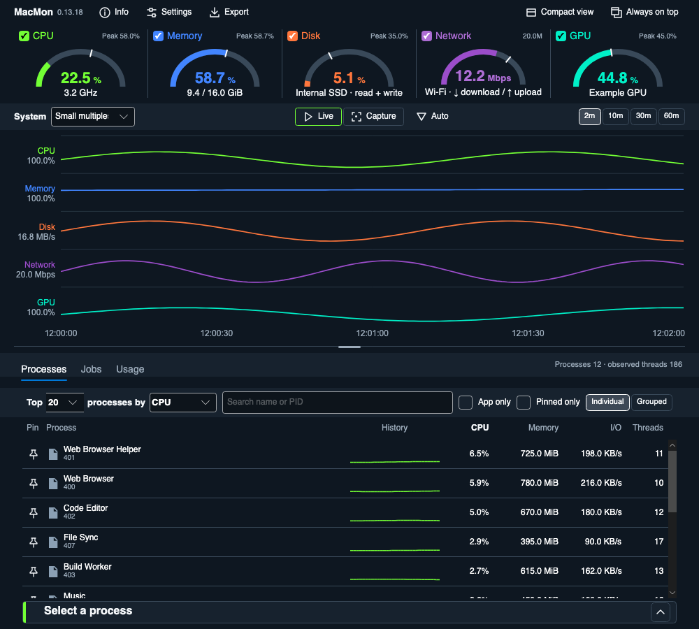](docs/example/example_small_multiples.png) | [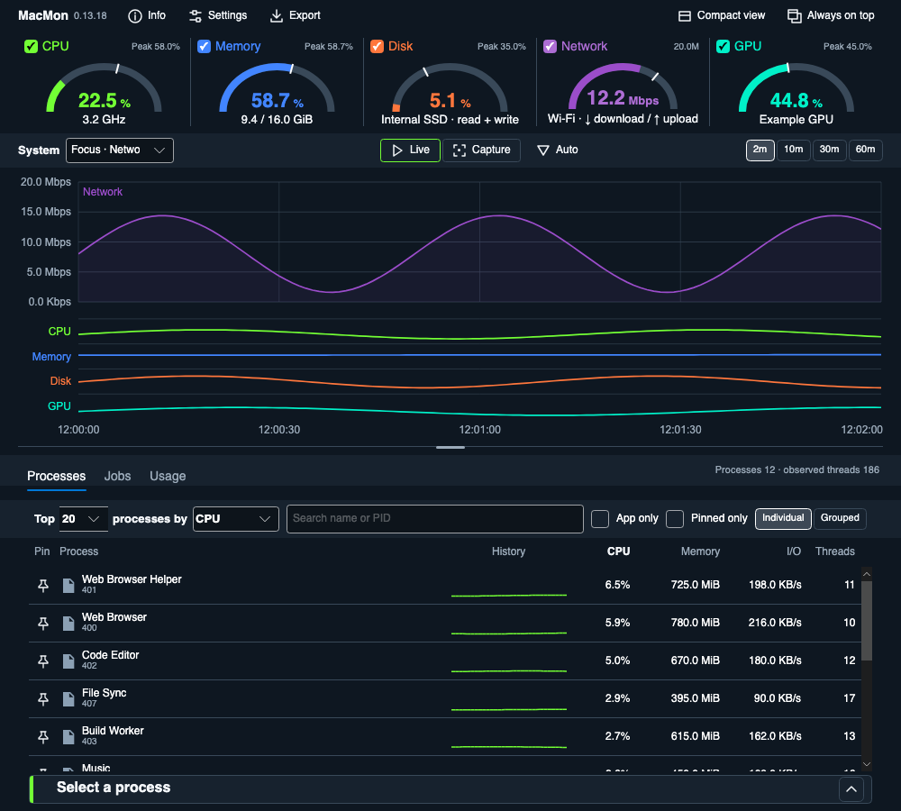](docs/example/example_focus_network.png) |

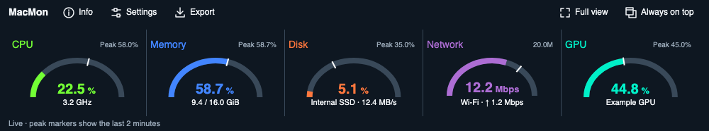

Compact and full-window dimensions are remembered separately. Settings, Export and Always on top work in both views. Choose Last view, Full view or Compact view as the startup view under Settings → General.

## Find the process behind a spike

Rank processes by **CPU**, **resident memory**, **disk I/O**, **threads**, **name** or **PID**. CPU readings use a five-second average; row histories show 30 seconds of recorded intervals for the selected metric. Histories share a scale across visible rows and leave gaps when readings are missing.

Switch between **Individual** processes and **Grouped** executables. Groups use exact executable paths. Grouped memory is a resident sum and can count shared pages more than once.

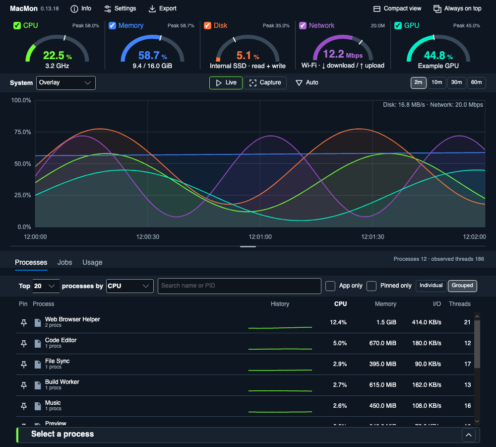

Search by name or PID. **App Only** matches executable paths inside `.app/Contents/MacOS`, including helpers and background apps; it does not mean apps with visible windows. Bundle icons come from macOS, with a generic fallback when unavailable.

Click column headings to sort or reverse direction. Choose Top All/5/10/20/50/100. Pin rows with the star beside their name or the row menu; matching pins stay above the rankings in insertion order and do not count against the unpinned limit. **Pinned Only** hides the ranked section.

<details>
<summary>How pins and selections follow processes</summary>

An individual pin or selection follows one process lifetime, so a reused PID cannot inherit it. Group pins follow the exact executable path and can match later instances. Search and App Only apply to pins too; a pinned process is not duplicated in the rankings.

Pins and view preferences save on clean exit. Individual pins restore only within the same boot. Historical observations can omit idle processes; unavailable values remain missing.

</details>

Select a process for **Properties**, **Copy details**, **More…** and a confirmed termination request. More includes Pin and **Reveal in Finder**; right-click offers row actions too. Termination protects system, other-user and MacMon targets, excludes processes started after the confirmation opens, and is disabled for historical views. Unsaved work can be lost when ending a process.

Collapse the selection action bar to make room. Processes, Jobs and Usage share that choice and remember it on restart.

## Follow launchd jobs and their workers

Choose **Jobs** to inspect loaded launchd jobs in MacMon's current bootstrap context. Search by label, PID or observed process; filter reported state and rank by name, state, PID, CPU, resident memory or disk I/O.

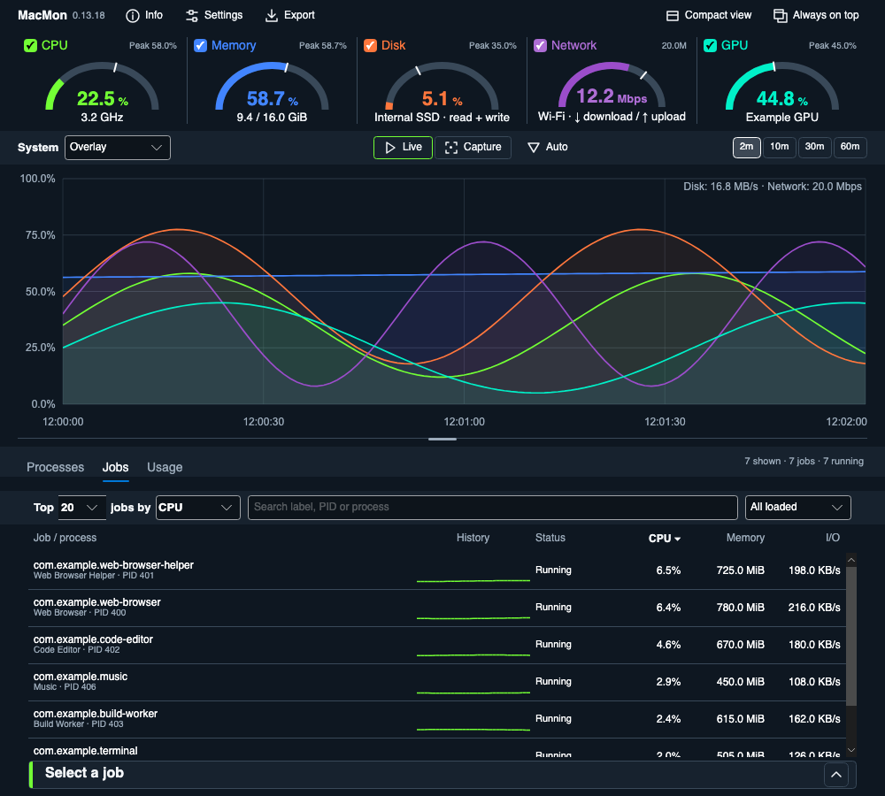

Verified direct-process readings and 30-second histories are separate from the job's reported state. Missing, stale or changed lifetimes remain unavailable. Child workers are excluded from table totals.

Select a job for read-only properties, copying and **Workers**, which opens an observed process tree. The tree refreshes every five seconds while visible and preserves selection. Job actions keep their selected target when filters or limits hide its row and follow a newly verified host after restart.

“Not running” does not mean disabled, and the last exit status does not describe current health. Other bootstrap domains, disabled-job configuration and reparented-worker attribution are outside this inventory. There are no job-control actions.

Capture mode uses the most recent job inventory observed at or before the selected sample, within 15 seconds. Session-only job history is bounded to 120 snapshots / 100,000 job references and is not restored across restarts. Worker trees require matching process lifetimes and are capped at 512 nodes and 16 levels below the root.

## See what used your Mac this session

Choose **Usage** to see observed CPU time and disk I/O by executable since MacMon started, including apps that have exited. Rows show CPU share, seen/running process counts and last activity. **Not attributed** holds machine busy time that cannot be assigned to an app; missing intervals are excluded.

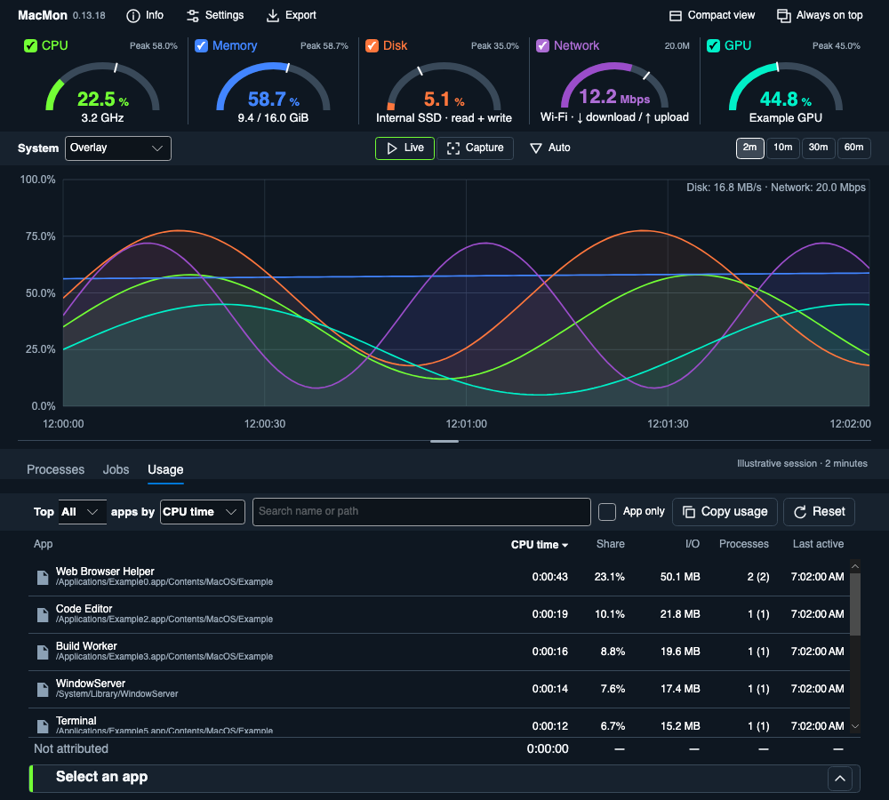

Search, rank, limit rows or enable App Only. **Copy Usage** copies displayed rows and Not attributed; Export includes all session totals. **Reset** begins totals again from now. Select an app for properties, copying and Reveal in Finder. **Show in Processes** returns to Live and filters by the exact executable path.

## Look back and catch the next spike

Hover the chart to preview readings. Click a moment or choose **Capture** to inspect retained process observations while recording and the top readouts stay live. Focus the chart and use Left/Right to step through samples, Home/End for visible boundaries, and Escape to return to Live.

**Copy capture** copies the current resource summary and process rows, including averaging notes. Historical samples can omit idle processes; memory-pressure and compressed-memory details remain live.

Enable **Keep history across restarts** under Settings → Monitoring to save bounded resource/process history on clean exit and reopen it in Capture mode. Usage normally starts fresh; saved capture reports remain available. History is not guaranteed after a crash or forced shutdown.

### Automatic captures

Configure a threshold, duration and cooldown for system CPU/GPU, estimated memory usage, primary/second-disk estimated I/O activity, network throughput or any one process's CPU. Open **Auto → Automatic capture settings…** or Settings → Automatic captures.

A fired rule marks the peak on the chart and saves a local text report. Choose a capture to inspect its retained peak, or open its saved report after history expires. Reports default to `~/Library/Application Support/MacMon/Captures`; each chosen folder keeps its newest 200 MacMon-owned reports. Changing folders leaves existing reports in place. Notifications are optional.

## Export readings as CSV

Choose **Export** in either view for resource history, retained process observations or session Usage totals. History exports offer all retained samples or the current chart range, then a native save dialog. Usage covers the session or the period since Reset.

CSV columns and stored identifiers stay invariant when the UI language changes. Memory uses binary units in the UI; disk I/O uses decimal units and excludes network traffic. Exported process history contains retained observations, not every process in every interval. Local reports and exports can contain process names and executable paths.

## Make it yours

Open **Settings…** or press **⌘,** for General, Appearance, Monitoring and Automatic captures. One Save applies all sections and writes preferences; Cancel discards edits. Settings reopens to the last section used during the session.

Choose System, Light or Dark and the WinMon finishes, with independently selectable palettes and color swatches. Theme changes choose the paired palette while Classic or the previous paired palette is selected; a custom palette stays selected. Colorblind and High-Contrast palettes give resource traces distinct line patterns.

Choose **Bowl**, **Needle**, **Segmented arc**, **Left bar**, **Bottom bar**, **Segmented bar** or **None** for resource gauges. Appearance previews the draft before saving.

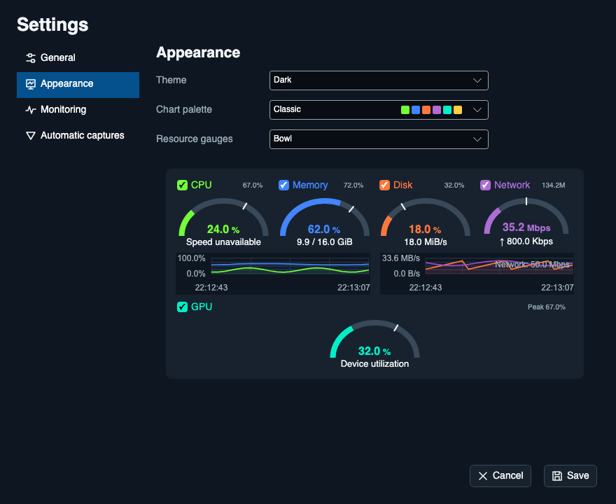

<details>
<summary>Compare palettes and Light appearance</summary>

| Neon | Arcade | Tropical |
| --- | --- | --- |
| [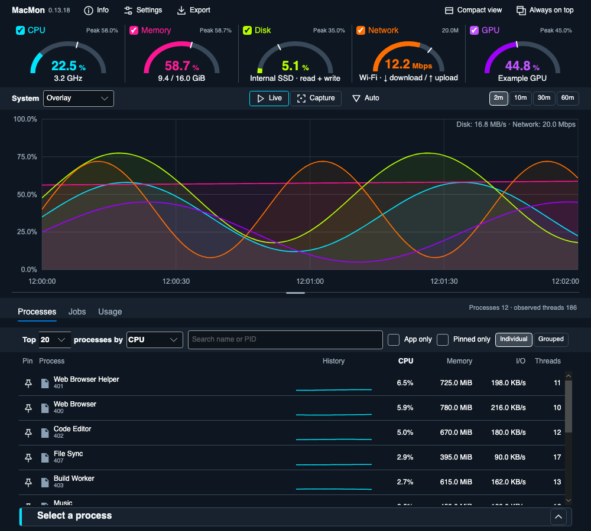](docs/example/example_neon.png) | [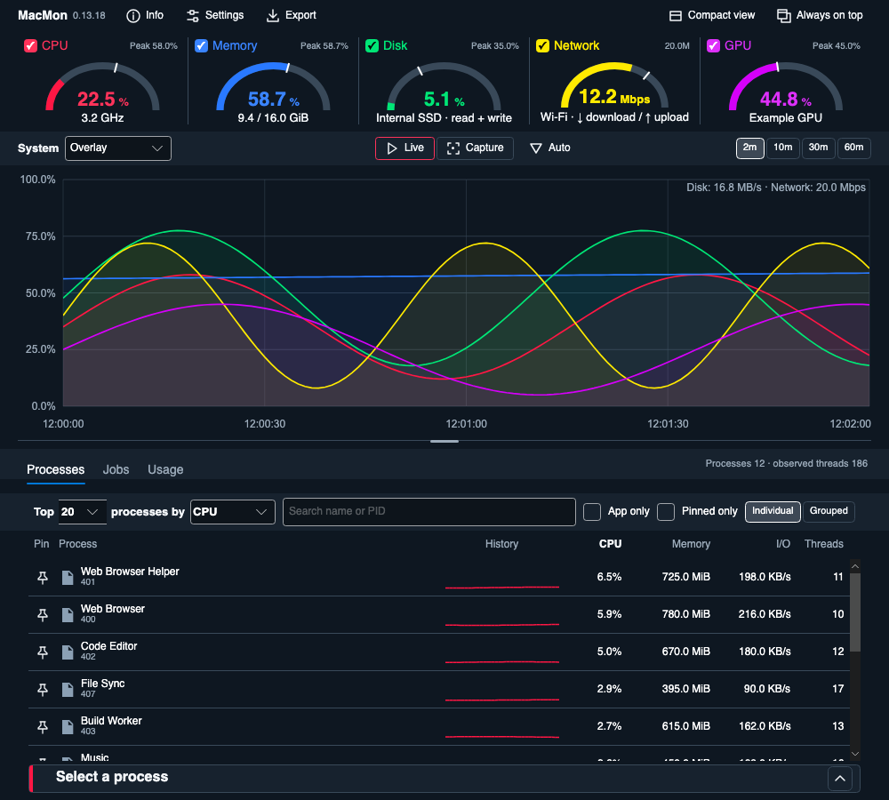](docs/example/example_arcade.png) | [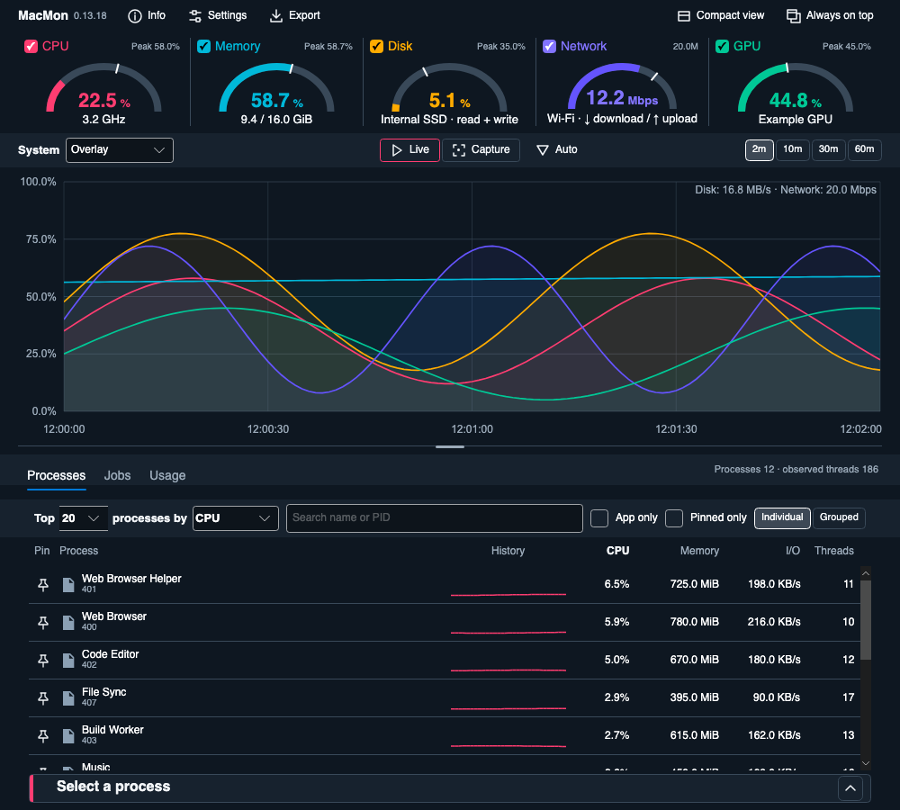](docs/example/example_tropical.png) |

[Light dashboard](docs/example/example_light.png) · [Light Compact view](docs/example/example_compact_light.png)

</details>

General offers English, Español or the system language, **Open at login** and an optional global shortcut. The recommended shortcut is **⌃⌥M**; shortcuts are off by default and work while MacMon is running. Login registration and notification options are available in the packaged app.

Monitoring selects history retention, a primary whole disk, an optional second disk and a network interface. Automatic network selection prefers an active Ethernet/Wi-Fi interface. Disconnected manual choices stay selected with unavailable readings. Disk images may appear; APFS volumes and partitions are excluded from disk choices. Aggregate readings include any selected second disk.

**Info** shows model/macOS build, processor and core counts, installed memory, reported memory-device details, graphics adapters, whole disks, mounted volumes and network adapters. Expand sections, refresh asynchronously or copy the timestamped report. Missing specifications stay unavailable; APFS volumes may share container capacity.

Preferences live at `~/Library/Application Support/MacMon/settings.json`. Invalid files are preserved and defaults are used.

## Performance

MacMon samples once per second using WinMon's portable MonCore library for sampling, ranking, selection and bounded history. Release-mode subsystem benchmarks on this Apple Silicon Mac, October 26, 2026:

| Measurement | Example result |
| --- | ---: |
| Native collection, 472 observed processes | 6.78 ms median/capture |
| Grouped process presentation, 850 processes with trails | about 3.5 ms/refresh |
| Jobs presentation, top 20 of 600 jobs | 0.309 ms/refresh |
| Allocations for that top-20 Jobs refresh | 209,856 bytes, down 83% |

These synthetic measurements exclude UI rendering and do not establish sustained whole-app CPU or resident memory. The full 600-job view reduced allocation by 63% with slightly higher refresh time. See [measurement details](docs/DEVELOPMENT.md#jobs-presentation-performance--october-26-2026) for before/after results and limitations.

## Updates

Release builds include Sparkle for verified automatic update checks and installation prompts. **Settings → General → Updates** offers a manual check and an automatic-check preference. Development packages keep updates disabled; older copies need one manual installation of an update-enabled release.

In-app updates preserve bounded history and session Usage even when normal restart history is disabled. The handoff is consumed once on the same boot within ten minutes. See [publishing and automatic updates](docs/RELEASING.md) for signing, notarization and recovery details.

## Build from source

Development requires macOS, Python 3 for local-package normalization and the .NET 10 SDK pinned in [global.json](global.json).

```sh
bash tools/bootstrap-moncore.sh
bash tools/verify.sh --smoke
dotnet run --project src/MacMon -c Release --no-build
```

Bootstrap uses a sibling `../WinMon` checkout by default, or accepts its path as the first argument. It builds **MonCore 3.4.1-macos.1** from a pinned upstream commit plus the [portable identity patch](dependencies/moncore/README.md), runs portable tests and writes the package to the ignored local feed. Existing branches and working files remain intact; shared source stays in WinMon.

To create a self-contained local application:

```sh
bash tools/package-app.sh
open artifacts/osx-arm64/MacMon.app
```

The bundle and versioned ZIP/checksum are ad-hoc signed for development. Close the running packaged app before rebuilding. Intel packaging accepts `osx-x64`; execution still needs Intel hardware validation.

See the [developer guide](docs/DEVELOPMENT.md) for contracts, verification and remaining work, the [gallery](docs/example/README.md#regenerate) to regenerate examples, and the [release guide](docs/RELEASING.md) to publish signed releases.

## A few useful details

- Disk percentages estimate **I/O activity**, not storage space used. Accumulated read/write operation times can overlap across operations and drivers; this differs from Windows active time. Missing timing counters stay unavailable. Charts retain throughput units, and the data volume's free space is separate in Info.
- Process memory is **resident memory**; grouped sums can count shared pages repeatedly. Process disk I/O excludes network traffic.
- GPU is device-wide IOAccelerator utilization for one stable adapter where exposed. Shared memory is labeled separately; per-process GPU and dedicated VRAM capacity are unavailable.
- CPU frequency is a requested-state estimate on supported Apple Silicon IOReport layouts. IOReport and IOAccelerator are optional, undocumented interfaces; unsupported readings stay unavailable.
- Baselines, failed readings and wake gaps remain unavailable rather than becoming zero. Very short-lived processes can exit between samples.

Built with C#, Avalonia and [MonCore from WinMon](https://github.com/galenblakeman/WinMon). Found a problem or have an idea? [Open an issue](https://github.com/galenblakeman/MacMon/issues).
