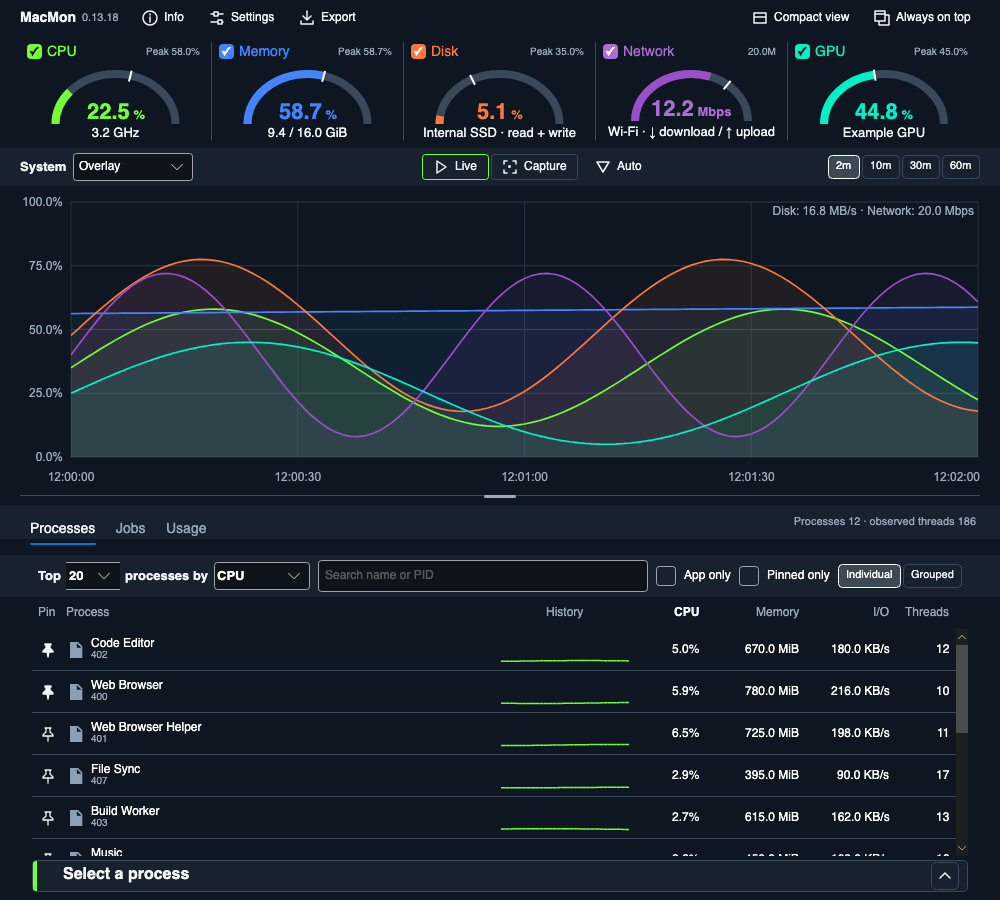
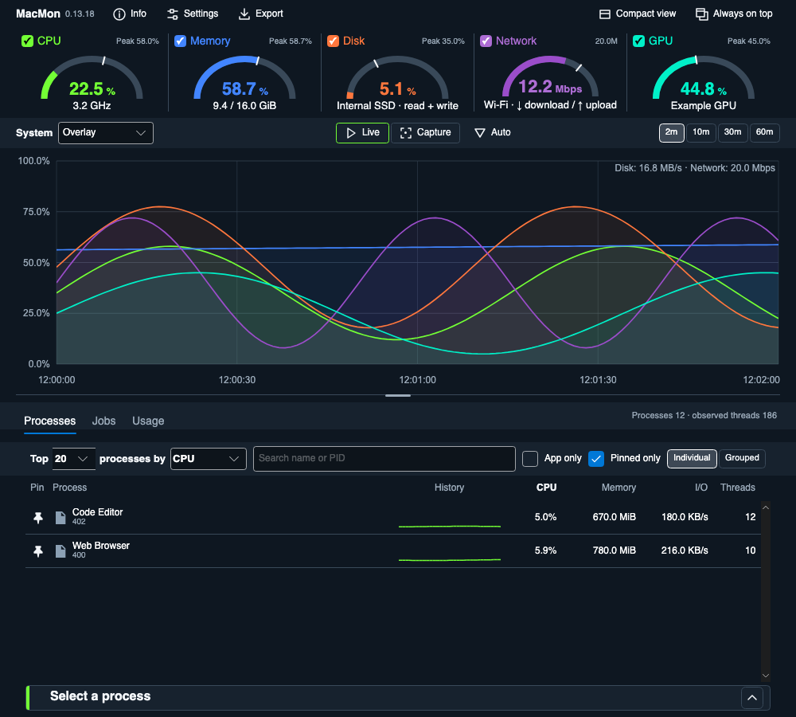
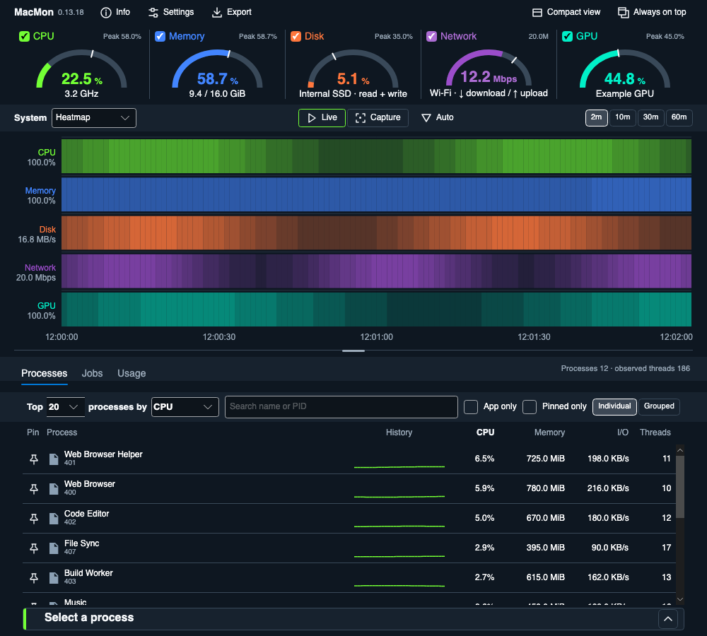
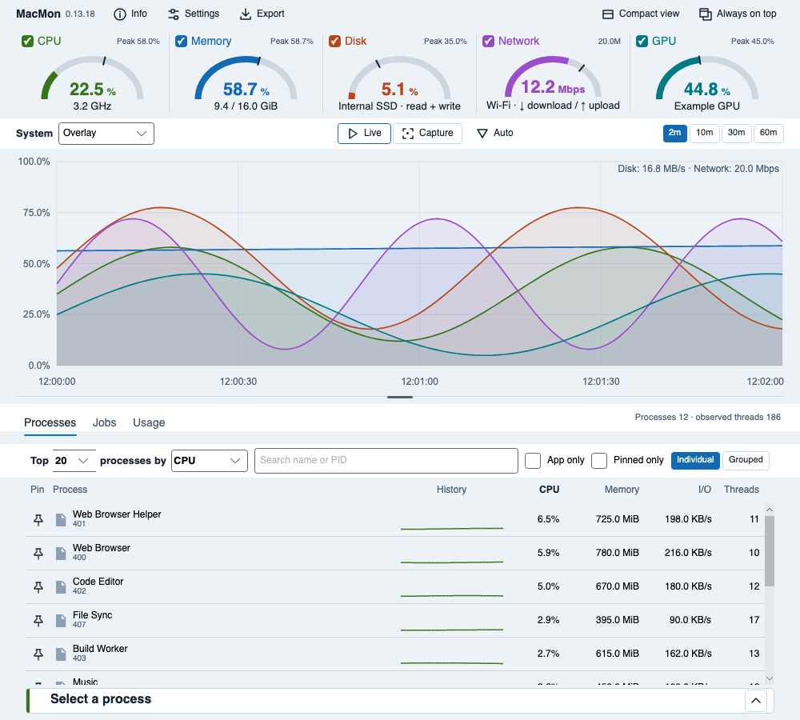
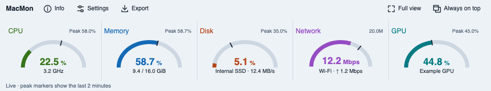

# MacMon screenshot examples

Gallery images were generated October 26, 2026, using MacMon **0.13.18**. They use illustrative process identities, launchd labels and measurements, rendered through the real Avalonia controls. They are UI examples, not performance measurements or evidence of native hardware readings.

These are **app-content renders** from Avalonia's headless Skia renderer. They omit native macOS window decorations and traffic-light buttons. The full dashboard is 1000 × 900 pixels; Compact view is 1000 × 186; Appearance settings is 880 × 720. Generic icons are expected for the illustrative executable paths.

[Return to the main README](../../README.md)

| File | View |
| --- | --- |
| [example_individual.png](example_individual.png) | Dark live dashboard, five resource gauges, Overlay history and individual process rankings. |
| [example_grouped.png](example_grouped.png) | Executable groups with resident-memory sums; the two browser processes share one executable path. |
| [example_pinned.png](example_pinned.png) | Code Editor and Web Browser pinned in insertion order above the unpinned rankings. |
| [example_pinned_only.png](example_pinned_only.png) | The same pins with Pinned Only enabled. |
| [example_apps_only.png](example_apps_only.png) | Grouped processes with App Only enabled, excluding the illustrative WindowServer path outside an app bundle. |
| [example_small_multiples.png](example_small_multiples.png) | Aligned resource charts with a shared time axis and separate scales. |
| [example_focus_network.png](example_focus_network.png) | Network Focus with its own throughput scale above the remaining resources. |
| [example_heatmap.png](example_heatmap.png) | Resource activity shown as heatmap lanes. |
| [example_jobs.png](example_jobs.png) | Seven illustrative loaded launchd jobs, verified direct-process readings and 30-second histories. |
| [example_usage.png](example_usage.png) | Session CPU time, CPU share, disk I/O, seen/running counts and Not attributed. |
| [example_compact.png](example_compact.png) | Dark Compact view with live resource gauges and two-minute peaks. |
| [example_compact_light.png](example_compact_light.png) | The same Compact view in Light appearance. |
| [example_light.png](example_light.png) | Full dashboard in Light appearance with Classic colors. |
| [example_neon.png](example_neon.png) | Dark dashboard with the Neon palette. |
| [example_arcade.png](example_arcade.png) | Dark dashboard with the Arcade palette. |
| [example_tropical.png](example_tropical.png) | Dark dashboard with the Tropical palette. |
| [example_settings.png](example_settings.png) | Appearance settings with theme, palette, gauge style and a combined preview. |

## Processes and pins

| Individual | Grouped |
| --- | --- |
|  |  |

| Pins above rankings | Pinned Only |
| --- | --- |
|  |  |

Memory is resident memory, and grouped sums may count shared pages repeatedly. App Only recognizes executable paths inside `.app/Contents/MacOS`, including helpers and background apps. It does not detect visible application windows.

## Resource history

| Small multiples | Focus: Network |
| --- | --- |
|  |  |



CPU, memory and GPU use percentage scales. Disk charts use combined read/write throughput; disk gauges estimate I/O activity. Network charts and gauges use download bits per second. These fixtures show a two-minute illustrative recording.

## Jobs and Usage

| Jobs | Usage |
| --- | --- |
|  |  |

Jobs are loaded launchd jobs in the current bootstrap context, with verified direct-process readings. Table totals exclude child workers; this is not Windows Services and offers no job-control actions. The example labels are fictional.

Usage groups observed CPU time and disk I/O by executable. CPU share compares app time with machine busy time; the illustrative recording does not represent a measured workload.

## Appearance and Compact view

| Light | Neon |
| --- | --- |
|  |  |

| Arcade | Tropical |
| --- | --- |
|  |  |





Settings uses the actual controls and their own illustrative preview. The example shows the development configuration; release builds expose Sparkle update controls under General. It does not demonstrate login registration, notification permission or update installation.

## Regenerate

From the repository root on macOS with the SDK pinned in `global.json` and the local MonCore package bootstrapped:

```sh
bash tools/bootstrap-moncore.sh
dotnet restore MacMon.slnx --locked-mode
MACMON_RENDER_OUTPUT="$PWD/artifacts/readme-examples" \
  dotnet test tests/MonCore.MacOS.Tests/MonCore.MacOS.Tests.csproj \
  -c Release --no-restore -m:1 -p:UseSharedCompilation=false \
  --filter 'FullyQualifiedName~DocumentationExamples'
```

The renderer is an explicitly selected documentation fixture; ordinary test runs skip it. It hosts the initialized dashboard content without opening the collector-owning main window, supplies fictional process and job rows, and renders English examples. It does not save preferences, copy to the clipboard, save capture reports or invoke process/job actions. It does not require an interactive desktop. Appearance preview timestamps may vary.

Use a fresh output directory, confirm the command succeeds, and inspect every `example_*.png` before replacing the gallery. After inspection:

```sh
cp artifacts/readme-examples/example_*.png docs/example/
```

Keep the version/date above and the main README's screenshot note in sync with the build used. The renderer lives in [DocumentationExamples.cs](../../tests/MonCore.MacOS.Tests/DocumentationExamples.cs).
